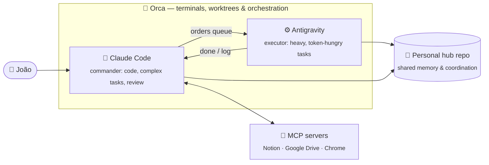

<p align="center">
  <a href="https://github.com/joaowatanabe">
    
  </a>
</p>

<p align="center">
  <a href="https://www.linkedin.com/in/joaowatanabe"></a>
  
  
  
</p>

---

## 👋 About me

```ts
const joao = {
  role: "Software Development Intern @ Coinpel (since Jul 2026)",
  studying: "Systems Analysis & Development — SENAC Pelotas (3rd semester)",
  workingWith: ["Laravel", "PHP", "PostgreSQL", "Docker", "integrated systems"],
  buildingWith: ["TypeScript", "Node.js", "React", "Next.js", "NestJS"],
  aiWorkflow: ["Claude Code", "Antigravity", "Orca", "MCP servers"],
  alsoInto: ["self-hosting / homelab", "music production", "cars", "games"],
  languages: ["Portuguese (native)", "English (professional)"],
  motto: "One step every day.",
};
```

I'm a developer from **Pelotas, RS 🇧🇷**, interning at **[Coinpel](https://www.coinpel.com.br/)** (Pelotas Tech Park), where I work on **Laravel** systems that talk to each other across several internal products. I came in having never touched PHP, so most of my growth there is learning *why* the code is built the way it is, not only *what* it does.

My bet: **with AI writing more of the code, the edge is reading it, reviewing it and making good decisions.** So I write code with agents every day, and I train myself to review that code without them.

**Open to remote and international opportunities.**

---

## 🌱 What I'm learning right now

<table>
<tr>
<td width="50%" valign="top">

### 🎓 At SENAC — 3rd semester

| Course | What it's teaching me |
| --- | --- |
| **Algorithms & Data Structures I** | Python: lists, dicts, sets, data analysis with Plotly |
| **Software Engineering II** | Clean Code and code review reports |
| **Databases II** | Advanced SQL on PostgreSQL + NoSQL with **MongoDB** |
| **Networking Fundamentals** | OSI/TCP-IP, addressing, number bases |
| **Services & APIs** | REST APIs in TypeScript |

</td>
<td width="50%" valign="top">

### 💼 At Coinpel — on the job

- Laravel the right way: **services, repositories, DI**, Eloquent vs raw SQL
- Many systems sharing data — integrations, not just CRUD
- Local env with **Laravel Herd + Postgres.app**, new projects on **Docker Compose (Colima)**
- Testing endpoints with **Bruno**
- Reading other people's code in a real codebase, every day

</td>
</tr>
</table>

### 🧭 My study path (one at a time)

```
 ✅ Clean Code  ──▶  🔄 SOLID & OOP  ──▶  ⏳ Testing (Vitest / Jest)  ──▶  ⏳ Architecture & design systems
```

I practice by reviewing **my own old repos without AI first**, writing down what's wrong and why, and only then comparing with an AI review.

---

## 🤖 How I work with AI

I don't just "use ChatGPT". I run a small **multi-agent setup** on my machine, coordinated through **[Orca](https://github.com/stablyai/orca)**:



- **Claude Code** is the coordinator: it writes code, takes on the hard problems, and reviews what the other agent delivers.
- **Antigravity** handles the simple but heavy work: extracting PDFs, cataloguing material, generating exercise banks.
- Both agents share a git repo that serves as long-term memory (an order queue plus a log), so either one can pick up where the other left off.
- **MCP servers** connect them to my Notion (study hub, journal, habits), Google Drive and browser. I also use custom **skills** and **graphify** knowledge graphs to turn notes and code into context.

---

## 🛠️ Tech Stack

**Languages & frameworks**

<p>
  
</p>

**Data**

<p>
  
</p>

**Tooling & environment**

<p>
  
</p>

**AI, agents & daily tools**

<p>
  
  
  
  
  
  
  
  
  
</p>

---

## 🚀 Projects & experiments

| Project | What it is | Stack |
| --- | --- | --- |
| 🏠 **Homelab on a TV Box** | An ARM64 Allwinner box running Linux/Termux 24/7 with **AdGuard Home** as DNS for the whole house: headless, boots on its own, blocks ads on every device | Linux · ARM64 · DNS |
| 🤖 **AI agent hub** | My personal "operating system": a git repo + Notion where Claude Code and Antigravity coordinate tasks, studies and routines | Claude Code · Orca · MCP |
| 🎧 **[analise-spotify-python](https://github.com/joaowatanabe/analise-spotify-python)** | Data structures assignment: analysis of the Spotify Tracks dataset with interactive charts | Python · Plotly |
| ✅ **[habit-tracker-laravel](https://github.com/joaowatanabe/habit-tracker-laravel)** | Habit tracker built to learn Laravel outside work | PHP · Laravel |
| 🎬 **[projeto-cinema-poo-senac](https://github.com/joaowatanabe/projeto-cinema-poo-senac)** | Cinema system modelled with OOP | TypeScript · Jest |
| ⏱️ **[chronos-pomodoro](https://github.com/joaowatanabe/chronos-pomodoro)** | Pomodoro timer | React · TypeScript |
| 🎨 **Portfolio (WIP)** | Built step by step as a learning exercise, aiming for Awwwards-level polish | Next.js · NestJS |

---

## 📊 GitHub Analytics

<div align="center">


</div>

---

## 🎧 Beyond the code

I've been a **DJ and music producer** for years. I release and play as **[@wabemusic](https://instagram.com/wabemusic)**, and Ableton Live is as familiar to me as my editor. It's the same loop as engineering: build something, listen to it, cut what doesn't work, ship it.

Also into cars, games and traveling.

<p align="center">
  
</p>

---

## 📚 Education & Certifications

- 🎓 **Systems Analysis and Development**, SENAC Pelotas *(in progress, 3rd semester)*
- 🎓 **[Full Stack Development](https://cubos.academy/cursos/desenvolvimento-de-software-v2)**, Cubos Academy
- 📱 **Mobile Developer Bootcamp**, DIO
- 💻 **+Praticar** program (web fundamentals)

---

## 🌐 Let's talk

<div align="center">

<a href="https://www.linkedin.com/in/joaowatanabe"></a>
<a href="mailto:jvwatanabe@gmail.com"></a>
<a href="https://instagram.com/wabemusic"></a>
<a href="https://discordapp.com/users/wabezada"></a>

</div>

<p align="center"><i>"One step every day."</i></p>


